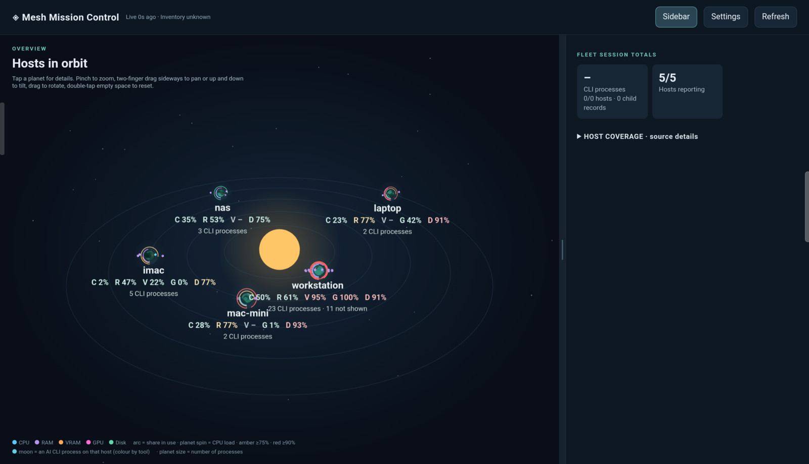

# Mesh Mission Control

**See every machine you run AI coding agents on, as a solar system.** Each computer is a planet on its own orbit, the arcs show its CPU, RAM, GPU and disk load, and every AI CLI running on it (Claude Code, Codex, Gemini, Hermes, Pi, OpenCode and about 20 more) is a moon. An Android app shows it; a small Python bridge collects it over SSH.



- **Read-only.** Nothing is installed on the machines you watch. The bridge only reads load and the names of your own processes.
- **Private.** The app talks to your own bridge over HTTPS, pinned to its certificate, with a token. No cloud, no account.
- **Easy to point at your machines.** Type their addresses, or discover them on your LAN or tailnet from the app.

## Quick start

You need: one always-on Linux or macOS machine for the bridge (Python 3.8+, `ssh`, `openssl`) that can SSH to the machines you want to watch, and an Android 6.0+ phone or tablet on the same network or tailnet.

**1. Start the bridge**

```sh
git clone https://github.com/earlvanze/mesh-mission-control-oss
cd mesh-mission-control-oss/server
python3 mmc.py serve
```

It prints an address, a token and a certificate fingerprint. Leave it running (see `deploy/mesh-mission-control.service` to run it as a service). Print them again any time with `python3 mmc.py pair`.

**2. Install the app**

Download `mesh-mission-control.apk` from the [latest release](../../releases/latest) on your phone, open it, and allow installs from that source when Android asks.

**3. Pair**

Open the app; Settings appears by itself. Tap **Find servers on this network**, or type the bridge's address (over Tailscale use its `100.x` address). Tap **Check and pair**, compare the fingerprint on screen with the one the bridge printed, paste the token, and tap **It matches. Save.**

**4. Add your machines**

Still in Settings, under **Hosts**, type a name and an IP or hostname (use `local` for the bridge machine itself), or tap **Discover on LAN** / **Discover on tailnet** and tap the ones you want. Fill in **SSH user** if it differs from the bridge's user.

The bridge logs in with its own SSH keys, so each host must accept them without a password. If one shows as unavailable, run this on the bridge machine and fix whatever it complains about:

```sh
ssh USER@HOST python3 --version
ssh-copy-id USER@HOST        # if it asks for a password
```

That's it. Planets appear within a few seconds and refresh every minute.

## Reading the picture

| You see | It means |
|---|---|
| Planet | One host. Size grows with the number of AI processes on it. |
| Arcs and `C R V G D` | CPU, RAM, VRAM, GPU and disk use. Amber from 75%, red from 90%. `-` means the host does not report it. |
| Moon | One AI CLI process, coloured by tool. If there are more than fit, the label says how many are not shown. |
| Tap a planet or moon | Details, plus **Peek** to see the end of that agent's output. |

Controls: drag to rotate; two fingers pinch to zoom, slide sideways to pan, slide up or down to tilt; double-tap empty space to reset.

It recognises Claude Code, Codex, Gemini, OpenCode, Hermes, Pi, ZCode, DeepSeek, Aider, Goose, Amp, Cursor, Qwen Code, Kimi, Crush, Droid, Copilot, Cline, Kilo, OpenHands, Forge, Plandex, Augment, Junie, Grok and Vibe, including ones installed from npm or pip that run under node, bun or python. Add more in `ALIASES` in `server/agent.py`.

## More about hosts

- **In the app:** Settings → Hosts.
- **CLI:** `python3 mmc.py add NAME ADDRESS [--user U] [--port N] [--key PATH]`, `python3 mmc.py discover [--lan] [--tailnet] [--add --user U]`, `python3 mmc.py remove NAME`.
- **File:** edit `~/.config/mesh-mission-control/hosts.json`, see `server/hosts.example.json`.

LAN discovery probes the SSH port on your own /24 subnets, only when you ask. Tailnet discovery reads `tailscale status` and skips phones and tablets. Host keys are recorded on first connection in `~/.config/mesh-mission-control/known_hosts`; a changed key is refused. Set `MMC_HOME` to keep the config somewhere else.

## How it works

```
Android app ──HTTPS, pinned certificate, bearer token──▶ bridge (server/mmc.py) ──SSH──▶ your hosts
```

Per host the bridge pipes a standard-library script (`server/agent.py`) to `python3 -c` over SSH. The script reads capacity numbers and the names and working directories of your own processes. It does not read terminals, prompts or files.

## Peek at a terminal

On by default. A **Peek** button appears on process cards; start the bridge with `--no-peek` to remove it. It fetches the last lines of that process's output, once, when pressed (never polled). It reads a Herdr pane or tmux pane if the agent runs in one; otherwise it summarises the end of that agent's Codex or Claude Code session transcript (your messages, the agent's replies and tool calls). Anything else is reported as unreadable. Escape sequences are removed and common credential shapes (API keys, bearer tokens, `token=…`) are masked, but terminal output can still contain sensitive text. Nothing is stored.

## Troubleshooting

| Problem | Try |
|---|---|
| App cannot find the server | Type its address and port (`192.168.1.20:18877`). Check the phone and bridge are on the same network or tailnet, and that nothing blocks port 18877. |
| "Not a Mesh Mission Control server" | Wrong address or port, or the bridge is not running. |
| Fingerprints differ | Stop. Something other than your bridge answered. Do not pair. |
| "The server rejected that token" | Copy the token again from `python3 mmc.py pair`. |
| A host is unavailable | Run `ssh USER@HOST python3 --version` on the bridge machine; it must work without a prompt. |
| A host shows no moons | No supported AI CLI is running as that SSH user. Moons only show processes of the user the bridge logs in as. |
| Peek says unreadable | The agent is not in tmux or Herdr and no Codex or Claude Code transcript was found. |

## Security notes

- The bridge listens on all interfaces by default so the app can find it. Use `--bind ADDRESS` to restrict it (for example to a Tailscale address). Anyone who can reach the port can read `/api/hello`; everything else needs the token.
- The token grants read access to your hosts' load and process names, plus changing the host list. Treat it like a password and rotate it by deleting `~/.config/mesh-mission-control/token` and restarting.
- Hosts you add are reached with the bridge user's SSH keys. Only add machines you control.

## Build the app

Needs the Android SDK (build-tools 35, platform 35) and a JDK:

```sh
ANDROID_SDK_ROOT=~/Android/Sdk android/build.sh
```

The APK is written to `android/build/`, signed with a key created at `~/.config/mesh-mission-control/release.keystore` on first build (override with `MMC_KEYSTORE`). Updating an installed app requires the same key; releases use the maintainer's key.

## Tests

```sh
cd server && python3 -m unittest -v test_server
```

## Licence

MIT. Bundles three.js (MIT), see `android/assets/THREE-LICENSE.txt`.
